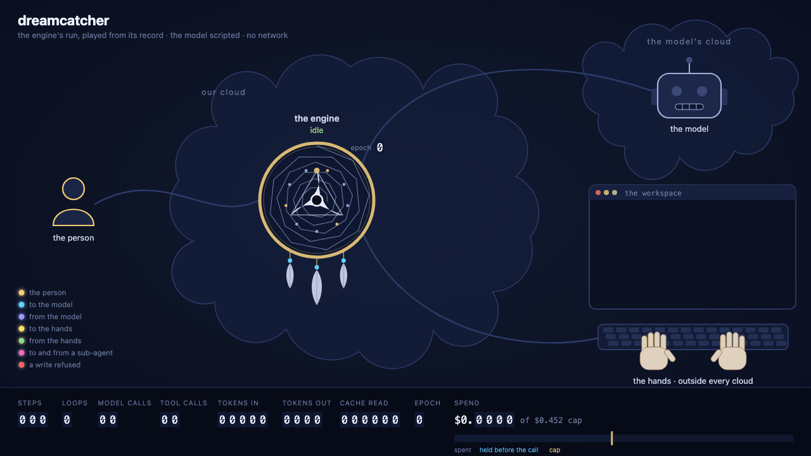

# dreamcatcher



The engine, in this process, on one terminal screen. It runs the
scaffold's engine as it sits, on its memory storage, with the scripted
twin as its model and a scripted director as its person. It reads no
key, opens no connection, and bills nothing.

## What it shows

One task in three acts: an agent fixes a failing check in a small
workspace.

1. **Simple.** One loop: plan, read, run, edit, run, done.
2. **Smart.** The person steers while a tool runs, and the next model
   request carries the steer. The agent asks the person, and parks
   until the answer comes. Two sub-agents review the change, and their
   reports reach the parent's history.
3. **Power.** The budget gate holds each call's worst case before the
   call starts. It parks the loop before a call that would cross the
   cap, and a raise wakes it. A runner dies in the middle of a tool
   call. The next run takes a new writer epoch and settles the call by
   its effect, so the edit lands once, and the old runner's write is
   refused.

## How to read the screen

- **The ring.** Each step the engine writes is a slice, from the top
  and clockwise, colored by its type. Each response draws a thread to
  its request, and each request a thread to the inputs it delivered. A
  newer thread stays nearer the rim, so the web spirals out as the run
  goes on. The center states the session as its history says it:
  running, parked on its reason, or idle.
- **The small rings.** Each sub-agent is a session of its own, with a
  ring of its own, tied to where its report landed.
- **The ledger.** Steps by type, loops, the step guard, parks, steers,
  calls recovered by their effect, the writer epoch, model calls,
  tokens, the window's fill, latency, and the spend against the budget
  with the gate's hold.

Every frame is recomputed from the steps and the usage records, never
from a counter of the demo's own. The run ends by replaying the ring
from the history alone.

## Run it

From the repository's root:

```bash
make demo                   # the screen, paced for a person, in a terminal of 120 by 36
make demo-check             # headless and fast: each act and the ledger checked against the record
vhs demo/dreamcatcher.tape  # records dreamcatcher.gif
```

`make demo-check` runs with a provider's key in its environment and
every outbound connection refused. It holds that the only model
provider the demo builds is the scripted twin, that each act happens in
the history, and that the closing ledger equals the record read back.
CI runs it.

## Where things are

- [`dreamcatcher/script.json`](dreamcatcher/script.json): the words.
  Each act's model turns, in the scripted twin's own format, and what
  the person says.
- [`dreamcatcher/acts.py`](dreamcatcher/acts.py): the cues. When a run
  starts, when the person speaks, when a runner is lost.
- [`dreamcatcher/engine.py`](dreamcatcher/engine.py): the engine, wired
  in process.
- [`dreamcatcher/workspace.py`](dreamcatcher/workspace.py): the
  workspace and its three tools.
- [`dreamcatcher/projection.py`](dreamcatcher/projection.py): each
  figure the screen shows, as a query over the record.
- [`dreamcatcher/screen.py`](dreamcatcher/screen.py): the frame, in
  ANSI and Braille.
- [`dreamcatcher/checks.py`](dreamcatcher/checks.py): what `--check`
  holds.

It sits outside the scaffold, so no copy of the scaffold carries it.
